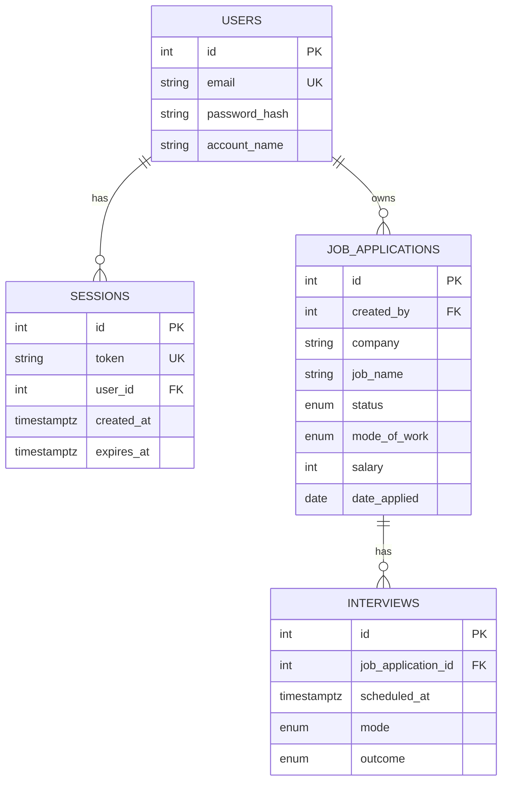

# Talaan: Architecture

## Stack
FastAPI, sync SQLAlchemy, PostgreSQL 16, Alembic, bcrypt. Sync routes only (see CLAUDE.md conventions).

## Domain layout
Done in Milestone 2 as a move-only commit. Applications and interviews have models and schemas only until CRUD.

```
app/main.py, config.py, database.py, health.py
app/auth/          router, schemas, models [Session], dependencies, security
app/users/         router, schemas, models
app/applications/  models, schemas, router, dependencies (service planned)
app/interviews/    models, schemas (router, service planned)
tests/             mirrors app/
```

## ERD

Columns are abridged; the full schema is in CLAUDE.md.

## Sessions vs OWASP Session Management
Matches:
- Random, unguessable token (`secrets`), stored server-side.
- `HttpOnly` cookie; logout and expiry delete the row (instant revocation).
- Same 401 for unknown email and wrong password.

Planned (v1b): hash tokens at rest, `Secure` and `SameSite=Lax` via config, rate limiting on login/signup.

Deliberate deviations:
- **30-day absolute lifetime**, no idle timeout, no sliding renewal. Data is low-stakes; convenience wins (DECISIONS.md).
- **No token rotation at login-time privilege change**: there are no roles.

## Testing
- Separate `*_test` database. A guard aborts if the configured DB name does not end in `_test`.
- Schema built once per run with `alembic upgrade head` (tests the migrations too).
- Each test runs in a connection-level transaction with a savepoint, rolled back at the end.
- `pytest` + `httpx` against the FastAPI app.

## Deploy topology
- Render free web service (Docker) + Neon free Postgres.
- App uses the Neon **pooled** URL; migrations use the **direct** URL. `pool_pre_ping=True` survives dropped connections.
- Container entrypoint runs `alembic upgrade head`, then `exec uvicorn ... --proxy-headers` (so signals reach uvicorn and client IPs are right behind Render's proxy).
- `.dockerignore` excludes `.env`; secrets are Render env vars.
- Cold starts: free instances sleep. A cheap `/ping` (no DB) lets a free uptime pinger keep it warm. The frontend must show a loading state while the API wakes.

## Future frontend
Vercel hosts the PWA. `vercel.json` rewrites `/api/*` to Render, so the browser sees one origin and cookies stay first-party.

## Caching
Authenticated responses send `Cache-Control: no-store`.

## CI
GitHub Actions (`.github/workflows/ci.yml`, free tier, no secrets). Runs on every pull request and every push to `main`; a newer push to the same branch cancels the older run.

One job, Python 3.14, Postgres 16 service container with database `talaan_test`. Config comes only from env vars: `DATABASE_URL` and `TEST_DATABASE_URL` both point at `talaan_test` (alembic reads the first, the test guard reads the second). Steps, each shown separately:
1. `pip install -r requirements-dev.txt` (pip cache on)
2. `ruff check app tests alembic`
3. `alembic upgrade head`
4. `alembic check`
5. `pytest -q`

Reproduce locally (with `docker compose up -d db` running):

    docker compose exec db createdb -U talaan talaan_ci_test
    export DATABASE_URL=postgresql+psycopg2://talaan:<password>@localhost:5432/talaan_ci_test
    export TEST_DATABASE_URL=$DATABASE_URL
    .venv/bin/python -m ruff check app tests alembic
    .venv/bin/python -m alembic upgrade head
    .venv/bin/python -m alembic check
    .venv/bin/python -m pytest -q
    docker compose exec db dropdb -U talaan talaan_ci_test

## Privacy and data
- Stored: email, password hash, account name, applications, interviews, session tokens.
- Sent to LLM providers: nothing today. From v1.2, only text the user explicitly submits, using their own key.
- Free-tier Gemini keys may use prompts for model training. The UI must warn before a user pastes personal text with such a key.
- No CV files are stored. Any CV feature (v2) uses an opt-in structured profile.
- Deletion on request now; self-serve account deletion in v1b.

## Extension points (hooks only, nothing built)
- **API tokens**: hashed personal tokens, accepted as `Authorization: Bearer` inside `get_current_user` next to cookies.
- **LLM provider interface**: one small interface behind which LiteLLM sits; BYO key, encrypted at rest, never logged.
- **JobSource interface**: yields job postings from legitimate feeds.
- **Per-user ownership**: every query is scoped by `created_by` through shared dependencies.
- **Secrets**: env vars only, never in git or logs.

Dev note: the Claude Code login is not an API key and must never power the app.

## Known limitations
Cold starts on free tier; Neon free-tier limits; no idle timeout; single region; no status history; no email delivery.

## Credits and inspiration
Ideas only, no copied code: career-ops (MIT), Resume-Matcher (Apache-2.0), JobSpy (MIT).
